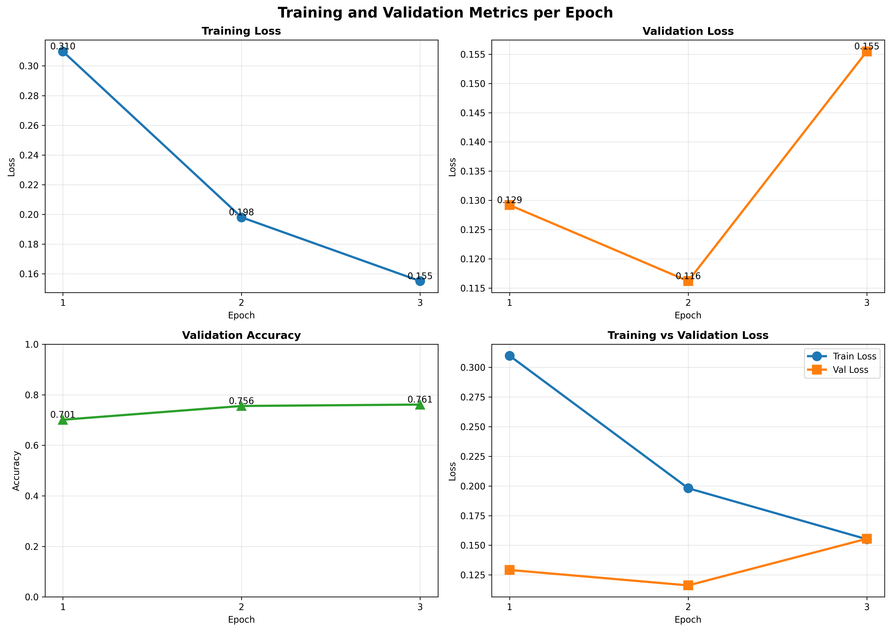
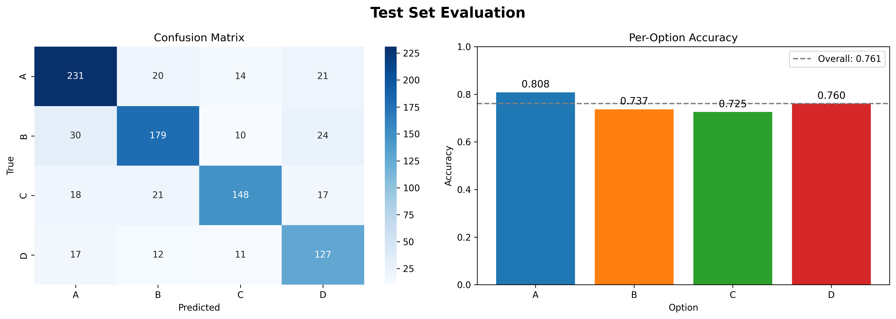
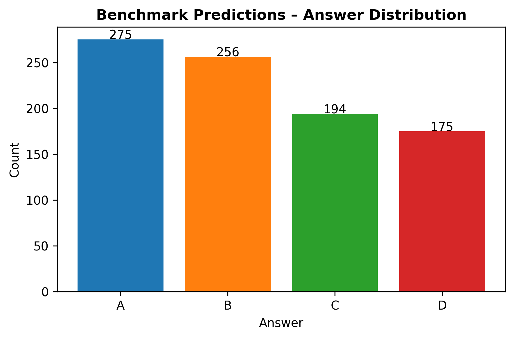

# PathoQA｜以 LoRA 微調 Llama 的醫學選擇題問答系統

使用 **Llama-3.2-1B-Instruct** 與 **LoRA**，建立從資料處理、模型微調、文字生成評估到多模型投票的完整流程。在 9,000 筆標註資料的 90/10 分層切分實驗中，最佳驗證準確率為 **76.11%**。

本專案由人工智慧課程作業延伸整理，展示大型語言模型的參數高效微調、結構化答案解析與實驗結果分析。

## 專案亮點

- **參數高效微調**：以 Hugging Face PEFT 加入 LoRA adapter，凍結基底模型權重，只更新適配器參數。
- **一致的問答模板**：訓練與推論共用包含一個 few-shot 範例的 prompt，答案格式為 `The answer is X.`。
- **以文字生成評估**：透過 `model.generate()` 產生答案，再解析 A/B/C/D，預測選項不依賴 logits 比較。
- **多種子集成**：以三組 seed 分別進行全資料微調，對生成的選項做 hard voting。
- **可追蹤的實驗輸出**：保存 adapter、訓練歷史、log、混淆矩陣與預測檔案。

**技術棧：** Python · PyTorch · Transformers · PEFT · scikit-learn · pandas · Matplotlib · Seaborn

## 實驗成果

第一階段使用 seed `42`，將 9,000 筆標註資料依答案類別分層切分為 **8,100 筆訓練資料／900 筆驗證資料**，依驗證準確率選出最佳 checkpoint。

| Epoch | Train Loss | Validation Loss | Validation Accuracy |
| --- | --- | --- | --- |
| 1 | 0.3097 | 0.1292 | 70.11% |
| 2 | 0.1980 | 0.1162 | 75.56% |
| 3 | 0.1551 | 0.1555 | **76.11%** |

數值取自 [`saved_models/training_history.json`](saved_models/training_history.json)。Train Loss 使用程式中的 loss 調整，Validation Loss 則為模型原始 loss，兩者不宜直接視為相同定義的指標。

> **評估範圍：** 預設 `test_ratio = 0.0`，程式中的 test set 與 validation set 是同一份資料。因此 log 的 `Test Accuracy` 也是 76.11%，並非獨立測試集成績。Benchmark 沒有提供標籤，本專案未回報其準確率，也無法由現有結果確認多種子投票是否提升準確率。

### 訓練曲線



### 混淆矩陣與各答案類別表現

以下圖表對應第一階段最佳 checkpoint 在 900 筆驗證資料上的評估；圖內沿用程式的「Test Set」命名。



## 方法與流程

```text
標註資料（9,000 筆）
  ├─ 第一階段：90/10 分層切分
  │    → LoRA 微調 → 逐 epoch 生成式驗證 → 選出最佳 adapter
  │    → 驗證資料評估、Benchmark 單模型預測與圖表
  │
  └─ 第二階段：使用全部標註資料
       → seed 42 / 52 / 62 各自從基底模型微調
       → 各模型生成 Benchmark 答案 → hard voting → predictions.csv
```

### Prompt 與訓練目標

每個 prompt 包含病理學問答指令、一個附簡短解釋的範例，以及題目與四個選項。訓練目標為 `\nThe answer is X.`，prompt 與 padding 的 label 設為 `-100`，只針對答案 token 計算損失。

範例中的解釋用來示範作答方式；訓練資料的目標只有答案句型，並未提供逐題推理過程的監督。

### 生成與答案解析

推論採 greedy decoding（`do_sample=False`），最多生成 64 個 token。答案解析優先匹配 `The answer is X`、`ANSWER: X` 等格式，再尋找獨立的 A/B/C/D 字母；若無法解析，會使用 NumPy 隨機選擇一個選項。

第二階段對每題取票數最多的選項。若三個模型各選不同答案，現行實作會採用 seed 列表中最先出現的答案。

## 快速開始

### 1. 準備環境

建議使用支援 BF16 的 CUDA GPU。程式以 `torch.bfloat16` 與 `device_map="auto"` 載入模型；CPU 執行的效能與相容性未驗證，專案也未記錄最低 GPU 記憶體需求。

在專案根目錄建立虛擬環境並安裝依賴：

```bash
python -m venv .venv
source .venv/bin/activate
python -m pip install -r requirements.txt
```

執行前需確保目前環境可以下載 `meta-llama/Llama-3.2-1B-Instruct`，並已取得所需的模型存取權限與 Hugging Face 認證。初次執行會下載基底模型。

### 2. 準備資料

將 CSV 放在以下路徑：

```text
dataset/
├── dataset.csv       # 含標籤的訓練資料
└── benchmark.csv     # 不含標籤的待預測題目
```

| 欄位 | 說明 | dataset.csv | benchmark.csv |
| --- | --- | --- | --- |
| `question_id` | 題目識別碼 | 必填 | 必填 |
| `question` | 題目文字 | 必填 | 必填 |
| `opa`, `opb`, `opc`, `opd` | A、B、C、D 選項文字 | 必填 | 必填 |
| `ans` | 正確答案，使用整數 0／1／2／3 對應 A／B／C／D | 必填 | 不需要 |

本次實驗的 Benchmark 共 900 題。CSV 應保留上述欄位名稱。

### 3. 執行訓練與預測

```bash
python main.py
```

預設會完成兩個階段：第一階段最多訓練 3 個 epoch，第二階段再以三組 seed 各訓練 2 個 epoch。第二階段完成後會以投票結果覆寫第一階段的 `predictions.csv`。

如果只要執行第一階段，修改 `main.py` 中的 `Config`：

```python
do_full_data_submission: bool = False
```

目前沒有命令列參數介面；其他設定也在 `Config` 中修改。重新執行會覆寫同名模型、圖表與預測檔，`train.log` 則採追加模式。

## 主要設定

| 設定 | 預設值 |
| --- | --- |
| Base model | `meta-llama/Llama-3.2-1B-Instruct` |
| LoRA rank / alpha / dropout | `32` / `64` / `0.1` |
| LoRA target modules | `q_proj`, `k_proj`, `v_proj`, `o_proj`, `gate_proj`, `up_proj`, `down_proj` |
| Batch size / gradient accumulation | `4` / `4`（名目有效 batch size 為 16） |
| 第一階段 epochs | `3` |
| Optimizer / learning rate / weight decay | AdamW / `1e-4` / `0.1` |
| Learning rate scheduler | OneCycleLR，`pct_start=0.1`，cosine annealing |
| 最大序列長度 / 最大生成長度 | `512` / `64` token |
| Early stopping patience | `2` |
| Train / validation / test ratio | `0.9` / `0.1` / `0.0` |
| 第一階段 seed | `42` |
| 第二階段 epochs / seeds | `2` / `[42, 52, 62]` |

`Config.label_smoothing = 0.1` 的現行實作是將 loss 調整為 `0.9 × loss + 0.1 × ln(4)`，並未對 token 目標分布實作標準 label smoothing。

## 專案結構與輸出

```text
.
├── main.py                                  # 資料處理、訓練、評估、投票與視覺化
├── requirements.txt                         # Python 依賴
├── README.md
├── dataset/
│   ├── dataset.csv
│   └── benchmark.csv
├── saved_models/
│   ├── best_lora/                           # 第一階段最佳 adapter 與 tokenizer
│   ├── checkpoint_epoch_*/                   # 第一階段各 epoch 的 checkpoint
│   ├── final_model/                         # 第一階段最後一個 epoch 的 adapter
│   └── training_history.json
├── predictions.csv                          # 最終 Benchmark 預測
├── training_metrics.png
├── test_results.png
├── benchmark_predictions_distribution.png
└── train.log
```

`save_pretrained()` 保存的是 **LoRA adapter 與 tokenizer**，載入時仍需要基底模型。第二階段的三組模型目前不會保存為 checkpoint，只輸出投票後的預測結果。

### 預測檔案

`predictions.csv` 保留 Benchmark 的 `question_id`，以 `pred` 欄位輸出答案，編碼為 `0 → A`、`1 → B`、`2 → C`、`3 → D`。

格式示例：

```csv
question_id,pred
1,2
2,0
3,1
```

本次實驗最終投票結果的分布為 **A：285、B：263、C：199、D：153**，共 900 題，紀錄於 `train.log`。

下圖是在第二階段開始前產生，呈現第一階段單模型的 Benchmark 預測分布，並非最終投票分布。



## 限制與後續方向

- **獨立評估**：目前驗證資料同時用於模型選擇與最終回報；後續可保留獨立測試集，以評估泛化能力。
- **答案解析品質**：隨機 fallback 會影響結果，後續可統計解析失敗率並改善輸出約束。
- **長題目處理**：序列上限為 512 token，過長的訓練樣本可能截掉答案 token；後續可改善截斷與資料過濾策略。
- **可重現性**：已設定 PyTorch 與 NumPy seed，但依賴僅指定最低版本，尚未固定完整套件版本與硬體環境。

## 發布檔案

作品集展示可保留原始碼、依賴清單、README、訓練歷史與成果圖。模型權重可另外託管，資料集的公開散布則需依原始來源的授權處理；本專案目前未附資料來源授權文件。
